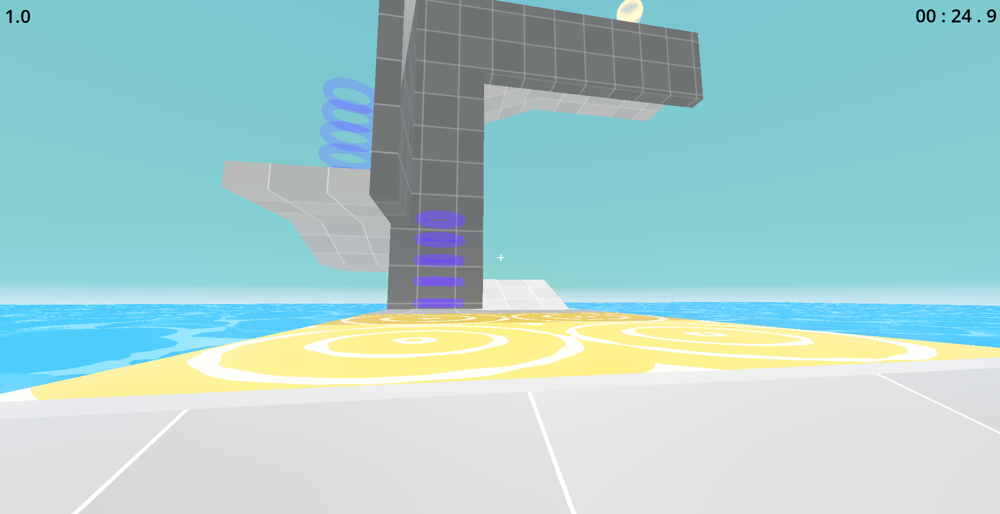

# Fast

3D platformer made for speedrun on godot

## what is it
I designed this 3D platformer with the idea of making a game based on speedrun, so I created a movement palette large enough for certain behaviors to emerge and allow you to create many ways to finish each level. I also implemented a level editor to allow everyone to make their own levels.

## how to play
put this project on godot 4.X and run
##